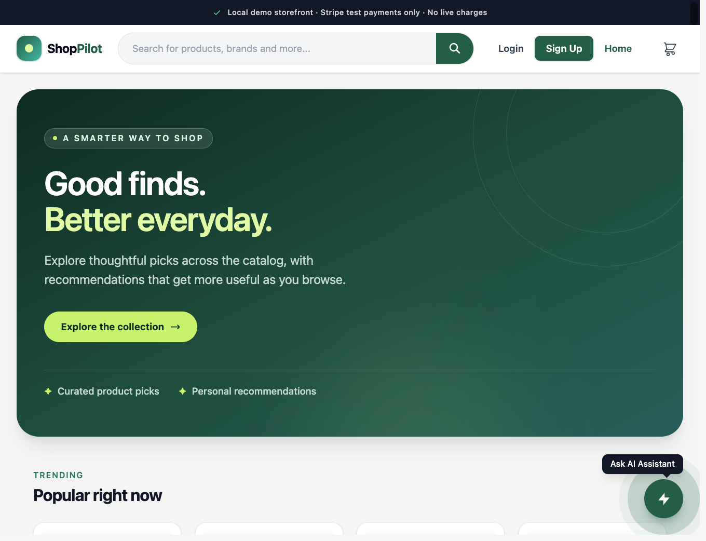
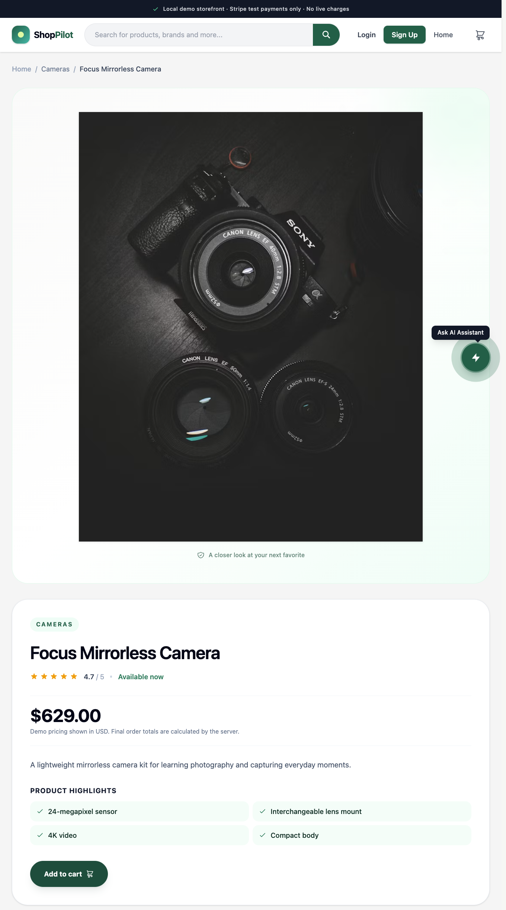

# ShopPilot AI

ShopPilot is a local-first AI-assisted e-commerce demo built with a React storefront
and a modular NestJS API. It is designed as a portfolio and learning project: run the
complete stack locally, explore the backend architecture, and try the commerce, AI,
search, and background-processing flows without requiring paid services.

> **Scope:** This is a demonstration, not a production-ready commerce platform.
> Stripe is restricted to test mode; shipping, tax calculation, inventory
> reservation, product enrichment, and currency conversion are not implemented.
> Kubernetes and paid managed services are intentionally deferred.

## Features

| Area                       | Included in this repository                                                                                                                      |
| -------------------------- | ------------------------------------------------------------------------------------------------------------------------------------------------ |
| Storefront                 | Product catalog, product detail, cart, signup/login, seller views, and Stripe test-checkout flow                                                 |
| API and data               | NestJS modular monolith, PostgreSQL, Prisma models/migrations, DTO validation, and OpenAPI docs                                                  |
| Authentication             | Password hashing, access/refresh JWTs, authentication guards, and buyer/seller role checks                                                       |
| Orders and payments        | Server-calculated order prices, idempotent checkout requests, Stripe-hosted test Checkout, signed/deduplicated webhooks, and order status checks |
| Search and recommendations | OpenSearch text/vector search, product embeddings when configured, activity-based profiles, and personalized product recommendations             |
| AI assistant               | OpenAI-compatible chat/embedding configuration, fallback model, usage/cost tracking, timeouts, and optional concurrency-safe daily budget        |
| Knowledge/RAG              | Shared and seller-owned documents, chunking, hybrid lexical/vector retrieval, source citations, and deterministic retrieval/grounding checks     |
| Agent tools                | Product and cart tools, authenticated order/ticket actions, audit records, and explicit confirmation for consequential actions                   |
| Background work            | Redis/BullMQ worker, PostgreSQL transactional outbox, retries, failure/dead-letter status, and queued order email                                |
| Integrations               | Authenticated read-only MCP tools, signed/idempotent generic inbound webhook receipts, SMTP adapter, and local Mailpit capture                   |
| Observability              | OpenTelemetry instrumentation, Prometheus metrics, Grafana dashboard/alerts, and optional Sentry exception reporting                             |

Some capabilities require optional provider credentials. Without an AI key, basic
catalog operations and keyword search remain available; AI chat and embeddings do
not. Checkout requires Stripe test keys and a forwarded webhook. Sentry is disabled
when its DSNs are empty.

## Screenshots

| Storefront home                                                      | Product details                                                         |
| -------------------------------------------------------------------- | ----------------------------------------------------------------------- |
|  |  |

## Quick start

Requirements: Docker with the Compose plugin. No separate Node.js installation is
needed for the Docker workflow.

```sh
git clone <your-repository-url>
cd <repository-directory>
cp .env.example .env
docker compose up --build -d
```

Compose starts PostgreSQL, OpenSearch, Redis, Mailpit, the NestJS API, the React
storefront, Prometheus, and Grafana. It runs database migrations automatically, but
does **not** seed product data on every start. Wait for the backend to become healthy,
then run the seed once:

```sh
docker compose ps
docker compose exec backend node backend/dist/seed.js
```

The seed inserts 213 demo products across 12 categories and creates the demo buyer
`buyer@ai-ecommerce.com` and seller `seller@ai-ecommerce.com`, both with password
`admin123`. Now open http://localhost:8080. Without this one-time seed, the site can
load but its product catalog will be empty.

Categories include Accessories, Audio, Cameras, Home & Living, Kitchen, Laptops,
Office, Outdoor, Smartphones, Tablets, Travel, and Wellness. Product photos are
remote demo assets; confirm their source terms before commercial use.

| Local service | URL                                                                       |
| ------------- | ------------------------------------------------------------------------- |
| Storefront    | http://localhost:8080                                                     |
| Backend API   | http://localhost:3500/api                                                 |
| API health    | http://localhost:3500/api/health                                          |
| OpenAPI UI    | http://localhost:3500/docs/v1                                             |
| Mailpit inbox | http://localhost:8025                                                     |
| Prometheus    | http://localhost:9090                                                     |
| Grafana       | http://localhost:3000 (local login: `admin` / `local-dashboard-password`) |

> **Warning:** seeding clears and recreates demo users, products, orders, and the
> OpenSearch product index. `docker compose down -v` also deletes local persisted
> database, search, and dashboard data.

## Project background

This repository builds on the AI e-commerce crash-course source snapshot (including
the NestJS/backend and React storefront) and extends it with payment, reliability,
knowledge retrieval, integrations, and observability features. The course-origin
features and implementation notes are described below; the rest of this README
documents how the current repository works and runs.

### 1. Personalization

- `backend/prisma/schema.prisma`: an `EventType` enum (VIEW, SEARCH, CART_ADD,
  CART_REMOVE, PURCHASE) and a `UserEvent` model (`user_events`), indexed on
  `(userId, createdAt)`. Migration `20260613000000_add_user_events`.
- `backend/src/history/`: `RecordEventDto`, the `PreferenceProfile` shape, and
  `HistoryService` (`recordEvent()` best effort, `getProfile()` folds the last 60
  events into a recency weighted profile: PURCHASE 5, CART_ADD 3, VIEW and SEARCH 1,
  CART_REMOVE -2, 14 day half life). `POST /api/history/event` (204) and
  `GET /api/history/profile`, both behind `OptionalJwtAuthGuard`.
- `backend/src/products/products.service.ts`: `popularPicks()`, `recommendForProfile()`
  (profile -> one embedded query -> OpenSearch kNN -> blended re-rank -> max three per
  category) and `recommendationReason()`.
- `GET /api/products/recommendations` returns `{ personalized, products[] }` with a
  `reason` on every pick, registered above the `GET :id` wildcard.

### 2. Agent actions: cancel an order, open a support ticket

- `PATCH /api/orders/:id/cancel` verifies ownership and expires an open Stripe
  Checkout session before cancelling an unpaid order. Purchase-history events are
  written only after a verified Stripe test payment.
- `SupportTicket` model (`support_tickets`, nullable `userId` / `email` / `orderId`).
  Migration `20260614000000_add_support_tickets`.
- `backend/src/tickets/`: `POST /api/tickets` (guests welcome via
  `OptionalJwtAuthGuard`, a guest leaves an email) and `GET /api/tickets` (your own,
  `JwtAuthGuard`).
- The chat agent knows who is asking: `POST /api/chat` runs behind
  `OptionalJwtAuthGuard`, puts the shopper's taste profile and five most recent orders
  into the system prompt, records the question as a SEARCH event, and gets two new tools,
  `cancel_order` and `create_ticket`, executed server side with the verified user id.
  Their outcome streams to the browser as an `action_result` event.

### 3. The storefront (`frontend/`, handed out as source, not typed)

React 19 + Vite + Tailwind: product grid and detail page, sign up / log in with token
refresh, cart, protected checkout, the chat widget (SSE reader, product cards, cart
actions, navigation and action results) and the "Recommended for you" rail calling
`/api/products/recommendations`. It is a standalone package (not an npm workspace of
the root), and Vite proxies `/api` to `http://localhost:3500`.

Not in this snapshot (they live in the full build on the Code with Jay platform): guest
sessions, the seller profile and seller analytics, and the step-by-step React build.

## Run it with Docker

Docker Compose starts PostgreSQL, OpenSearch, Redis, Mailpit, the API, and the
storefront. It applies database migrations before starting the API. Redis backs the
BullMQ worker, which drains the transactional outbox for purchase-history events and
order-confirmation email.

```sh
docker compose up --build
```

Open http://localhost:8080. The API is also available at http://localhost:3500, with
`GET /api/health` as its health check. This setup uses local-only database credentials
and fallback JWT secrets, and binds services to localhost; it is for local development,
not a public production deployment. Replace credentials and use managed/secured data
services before hosting publicly. You can provide
`JWT_SECRET`, `JWT_REFRESH_SECRET`, and `OPENAI_API_KEY` in your environment or root
`.env` file. The OpenAI key is optional: without it, keyword search and popular picks
work, but embeddings and AI chat are unavailable.

For source-mode development, seed with `npm run seed --workspace=backend`. For a
Docker-only setup, use `docker compose exec backend node backend/dist/seed.js`.
**Seeding clears and recreates the demo users, products, orders, and OpenSearch index.**

Stop the services with `docker compose down`. To also delete the local database and
search data, use `docker compose down -v`.

## Stripe demo checkout

Checkout uses Stripe-hosted Checkout in **test mode only**. The app rejects live
Stripe secret keys, computes prices from the current product catalog, and records
purchase history only after a signed Stripe webhook confirms payment. Card details
are entered on Stripe and are never handled or stored by this app.

1. Create a Stripe account and use its test-mode secret key as `STRIPE_SECRET_KEY`
   in the root `.env` file.
2. Install the Stripe CLI, then run
   `stripe listen --forward-to localhost:3500/api/payments/stripe/webhook`.
   Copy the CLI's `whsec_...` value into `STRIPE_WEBHOOK_SECRET` in `.env`.
3. Keep `FRONTEND_URL` set to `http://localhost:8080` when using Docker Compose
   (change it to `http://localhost:5173` when running the Vite frontend from
   source), then start/restart the app.
4. Use Stripe's test card `4242 4242 4242 4242` with any future expiry date and
   any three-digit CVC. No real payment is taken.

The authenticated checkout endpoint is `POST /api/orders/checkout` with an
`Idempotency-Key` header and product IDs/quantities only. Stripe's signed webhook
endpoint is `POST /api/payments/stripe/webhook`; it deduplicates events and safely
handles completed, failed, and expired test checkout sessions. The return page
checks the authenticated order status and does not treat the redirect itself as
proof of payment. Without Stripe test keys and a forwarded webhook, checkout is
unavailable by design.

## Local order email

After Stripe confirms a test payment, the same database transaction that marks
the order paid writes an order-confirmation email to the transactional outbox.
BullMQ sends it through SMTP, and local Docker Compose provides Mailpit to capture
messages without delivering real email. Open http://localhost:8025 to inspect them.
For source-mode development, the example config connects to Mailpit on
`localhost:1025`.

The backend uses standard SMTP configuration (`SMTP_HOST`, `SMTP_PORT`,
`SMTP_SECURE`, optional `SMTP_USER`/`SMTP_PASSWORD`, and `EMAIL_FROM`). Production
deployment must configure an authenticated email provider/relay, verify its sending
domain, and monitor delivery and outbox failures. Providers with an SMTP relay (such
as Resend's SMTP endpoint) can be configured without changing application code;
direct provider APIs would need an adapter. No real outbound provider credentials
are included. Delivery is at-least-once: a process crash after a relay accepts a
message but before the outbox marks it processed can cause a duplicate.

## Run from source

For frontend/backend hot reload, first start only the local data services:

```sh
cp .env.example .env
docker compose up -d postgres opensearch redis mailpit
npm ci
npm run migrate:deploy --workspace=backend
npm run seed --workspace=backend
npm run dev:backend
```

In another terminal, run `cd frontend && npm ci && npm run dev`, then open
http://localhost:5173.

Checkout requires an `Idempotency-Key` request header. The checkout client reuses
its key when retrying a request, so a response lost after the database commit does
not create a duplicate order. Reusing the same key with a different order body
returns a conflict. The server snapshots catalog prices when creating the pending
order; the order and purchase-history outbox events are committed only after the
verified Stripe payment succeeds. The worker retries failed jobs with exponential
backoff; after the configured attempts, the event is retained with `FAILED` status
and the error in `outbox_events.lastError` for operator review. `REDIS_URL`
configures the local Redis connection.

## AI knowledge, integrations, and operations

The assistant can retrieve store knowledge documents in addition to products.
Ingestion chunks content with overlap and stores optional embeddings. Retrieval blends
keyword overlap with vector similarity when an AI API key is configured; without one,
it uses keyword search. Answers display source links as citations. Repeatable retrieval
cases and reference-answer evidence checks live in `backend/evals/rag-evaluation.json`
and `backend/src/knowledge/knowledge.service.spec.ts`; these are deterministic
retrieval/grounding checks and do not claim to score live model-generated answers.
Run them with:

```sh
npm test --workspace=backend -- --runInBand src/knowledge/knowledge.service.spec.ts
```

- Sellers can manage their own private documents at
  `/api/knowledge/seller/documents` using a seller JWT. Private seller content is
  excluded from buyer and guest retrieval.
- Shared FAQ, policy, manual, and seller-information documents can be managed at
  `/api/knowledge/admin/documents` with the `X-Knowledge-Ingestion-Token` header.
  Configure `KNOWLEDGE_INGESTION_TOKEN` before using those endpoints.
- The MCP endpoint is `/api/mcp`. Set `MCP_API_TOKEN` and send it as a bearer token.
  Its tools are read-only product and shared-document lookup; it does not expose
  checkout, order cancellation, or private seller content.
- Inbound generic webhooks are accepted at `/api/integrations/webhooks/:provider`.
  Configure `WEBHOOK_SECRETS` as a JSON map of provider names to random secrets.
  Sign the exact raw request body with HMAC-SHA256 and send
  `X-Webhook-Signature: sha256=<hex>`, `X-Webhook-Id`, and `X-Webhook-Event`.
  Payloads are limited to 100 KB. Generic provider receipts are deduplicated;
  Stripe payment events use the separate signed Checkout handler described above.
- OpenAPI is available at `/docs/v1` and `/docs/v1/openapi.json`. The API still uses
  the existing `/api` route prefix; the docs path is a versioned documentation
  snapshot, not a second versioned route tree.
- Prometheus scrapes API and AI metrics at port `9464`. Local dashboards and alert
  rules are provisioned in Grafana at http://localhost:3000 (default local login
  `admin` / `local-dashboard-password`) and Prometheus at http://localhost:9090.
  Configure `GRAFANA_ADMIN_PASSWORD` before exposing either service beyond localhost.
- Optional Sentry error reporting can be enabled for both the backend and storefront.
  Add `SENTRY_DSN` for the backend and `VITE_SENTRY_DSN` for the frontend to the root
  `.env`; set the corresponding environment values to `local`, `staging`, or
  `production`. The frontend DSN is public and is baked into the Vite bundle at build
  time (including Docker builds), while the backend DSN should be managed as a server
  secret. Blank DSNs disable Sentry, so local development works without an account.
  The SDKs do not collect default PII, and event scrubbing removes request bodies,
  query strings, and sensitive headers. Review Sentry retention, access, sampling,
  and privacy settings before sending production events.
- AI models are configurable with `AI_API_BASE_URL`, `AI_API_KEY`,
  `OPENAI_CHAT_MODEL`, and `OPENAI_FALLBACK_CHAT_MODEL`. This supports
  OpenAI-compatible endpoints; it is not a native adapter for every provider.
  `AI_DAILY_BUDGET_USD` requires input/output per-million-token rates. Model output
  is capped at 1,200 tokens and requests have a timeout. With the budget enabled,
  the API atomically reserves estimated cost in PostgreSQL before each model request;
  reservations expire after twice the request timeout if a process crashes.
  Reservation estimates use a character-based input-token estimate and the full
  1,200-token output cap, so they are intentionally conservative, not a provider
  billing guarantee.

## Production work for the deployer

The app's current Redis/BullMQ outbox, authenticated MCP, document retrieval,
signed webhook intake, Stripe test checkout, and local OpenTelemetry/Prometheus/
Grafana setup are development baselines, not a production service offering. Before
launch, the operator/deployer must adapt and verify them for the selected providers
and hosting environment:

- **Dependency audit (checked 2026-11-07):** the backend production audit reports
  zero known findings after upgrading to Prisma 7.10.1 and pinning the NestJS
  Multer dependency to patched 2.5.0. The full backend audit still reports
  lower-severity development-tool advisories, but no high-severity backend findings.
  Re-run `npm audit` before deployment because advisories change.
- **Payments and integrations:** use production Stripe credentials stored in a
  secrets manager, configure the production webhook endpoint and allowed events,
  verify payment/refund/reconciliation operations, and select and configure any
  shipping, tax, product enrichment, currency conversion, inventory, email, and CRM providers. This code intentionally accepts
  only Stripe test secret keys; enabling live payments requires an explicit,
  separately reviewed change. Set up provider-specific webhook retries, delivery
  monitoring, credential rotation, and customer-support procedures.
- **Shipping, tax, catalog enrichment, and currency:** these are not currently
  integrated. The `.env.example` contains reserved provider/key names to make the
  future configuration shape visible; the application does not read them or call
  those providers. Before implementing them, select providers, handle credentials
  and webhooks, and verify rates, tax rules, product-data licensing, and exchange-rate
  freshness. Do not treat demo prices or display-only conversions as authoritative
  checkout amounts.
- **Reliability:** deploy durable, authenticated Redis and managed PostgreSQL;
  alert on outbox/queue backlog and dead-letter events; define retry and recovery
  ownership; and implement stock reservation, payment failure, cancellation, and
  reconciliation rules before enabling real inventory or fulfillment. Local
  checkout does not reserve stock.
- **AI, MCP, and APIs:** choose and contract with providers, configure production
  credentials and tenant/data access policies, review the indexed content, expand
  retrieval/answer evaluations, and define API client scopes, rate limits, audit
  retention, and user confirmation requirements for consequential tools.
- **Operations:** select an OpenTelemetry collector and durable telemetry backend,
  define measurable SLOs and alert recipients, add database/OpenSearch/queue
  exporters, configure optional Sentry projects and alert ownership, and test
  dashboards and alerts.
- **Hosting and recovery:** configure TLS, production CORS/origins, managed service
  networking, least-privilege secrets, backup retention and restore drills,
  vulnerability/image scanning, staged migrations, deployment promotion, and
  rollback procedures. Kubernetes and paid managed services are optional choices,
  not prerequisites for this local demo.

Order cancellation and support-ticket creation by chat require explicit confirmation.
Pending confirmations expire after ten minutes and successful, rejected, or failed
actions are audited. Stripe test Checkout is configured for demos. Production
payment mode, shipping, tax, product enrichment, currency conversion, inventory, CRM,
email, outbound webhooks, and provider-specific
inbound webhook handlers require provider selection and deployment configuration;
see [Production work for the deployer](#production-work-for-the-deployer).

## CI

GitHub Actions runs backend tests and builds, the frontend build, and Docker image
builds on pushes and pull requests. GitHub hosts the source and CI workflow; deploying
the full app requires a host that can run Docker Compose and persistent PostgreSQL and
OpenSearch services. Kubernetes is intentionally out of scope for this portfolio-sized
setup.

When OpenAI API credits are available, add the key to the root `.env` and restart the
backend. Chat will then be available. To enable semantic search and personalized
recommendations, rerun the seed command to generate and index product embeddings.
**Seeding clears and recreates the demo users, products, orders, and OpenSearch index.**

## It works when

- Logged in as `buyer@ai-ecommerce.com` / `admin123`, a few product views turn the home
  page rail into "Recommended for you", each card with a reason line.
- In the chat widget, "cancel my last order" asks for confirmation before cancelling
  your newest unpaid order; "my laptop arrived cracked" opens a support ticket.
- `backend/request.http` exercises every endpoint, ending with cancel, tickets and a
  chat request that asks the agent to cancel.
